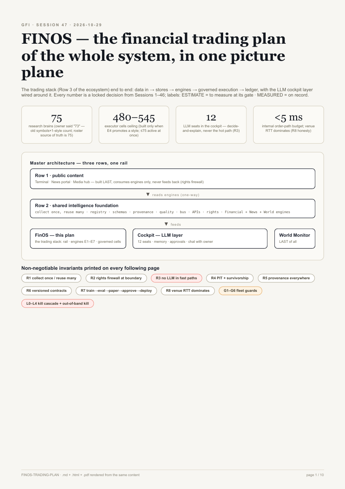
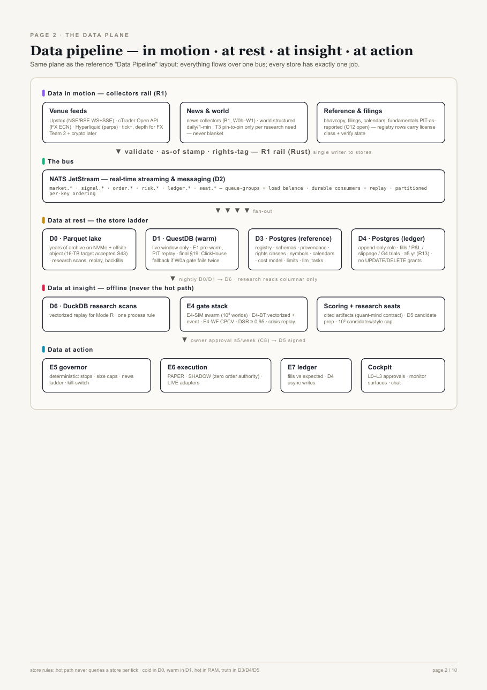
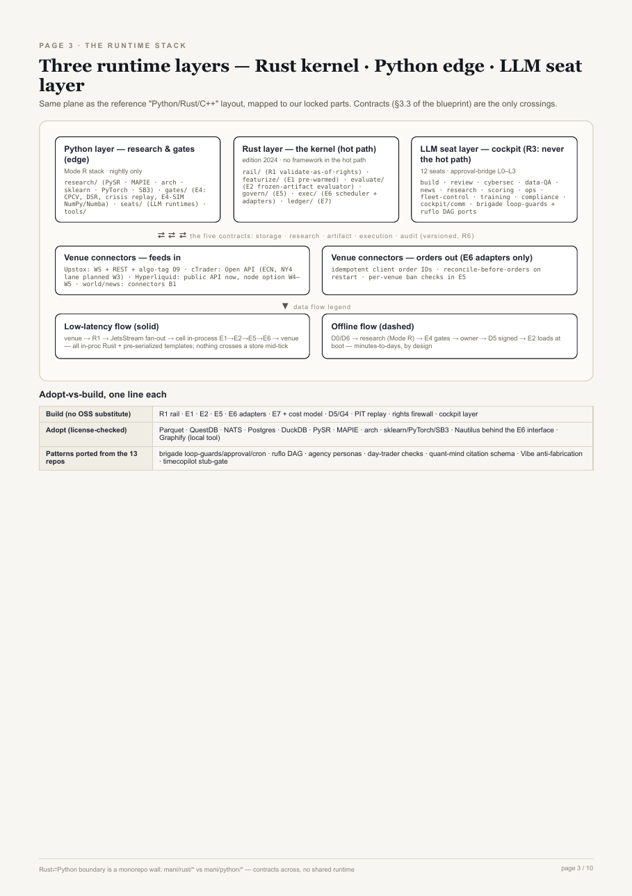
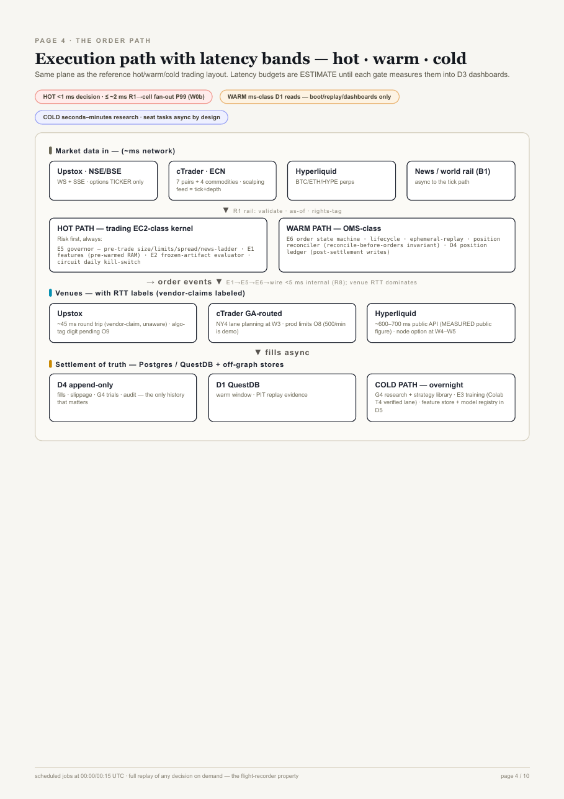
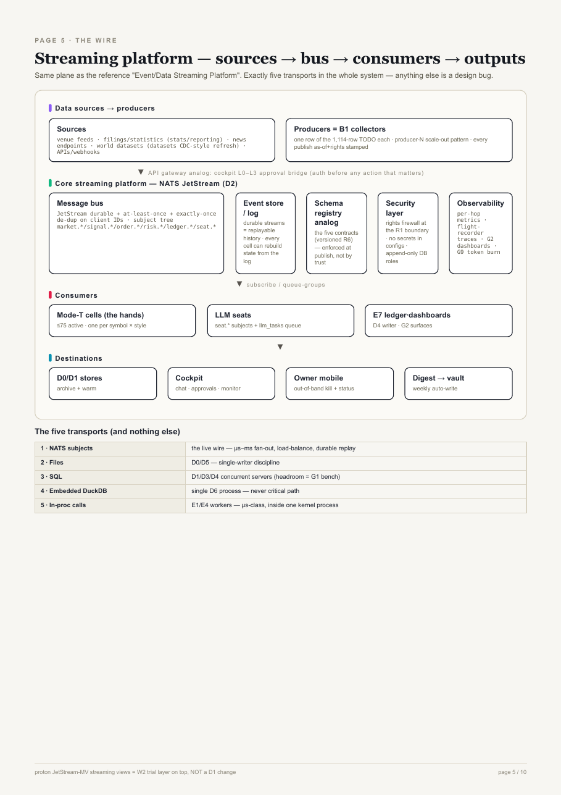
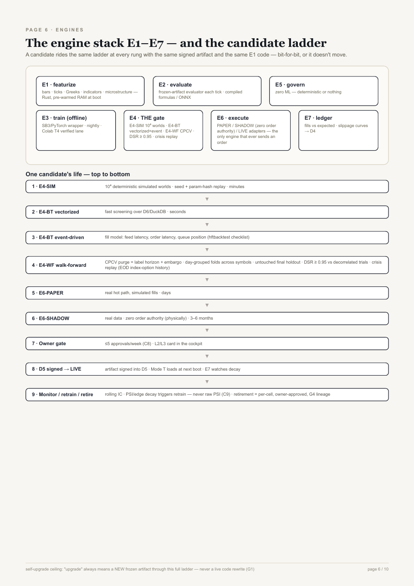
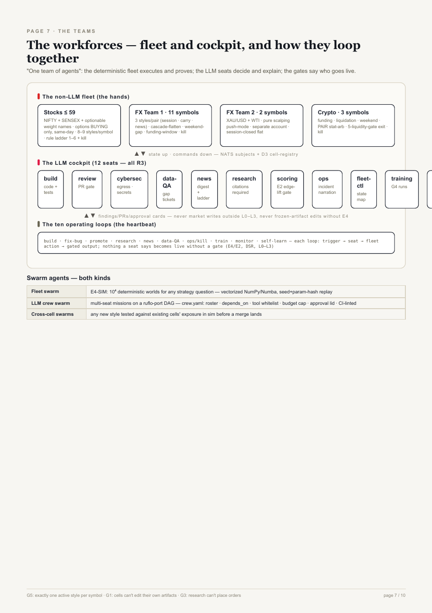
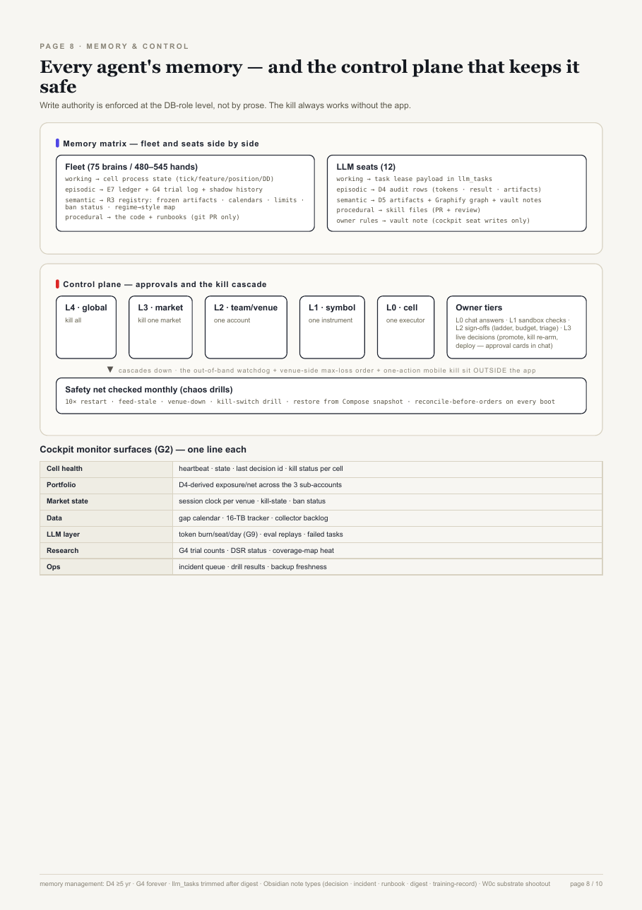
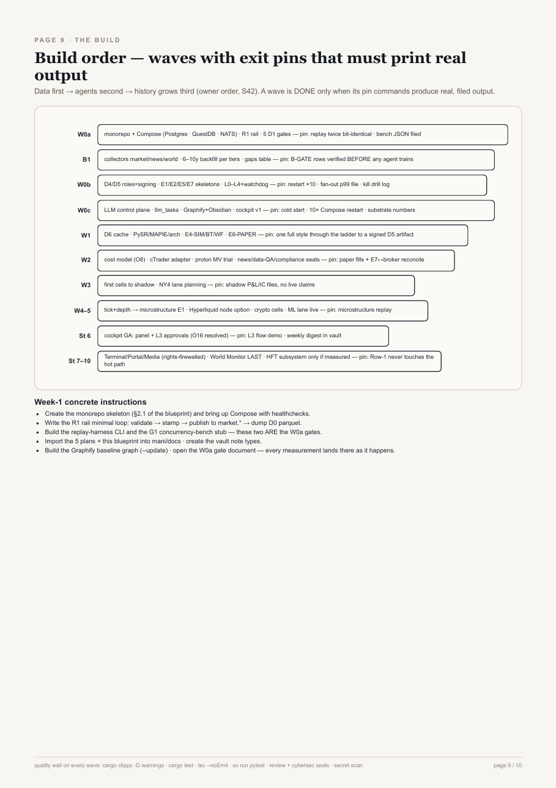
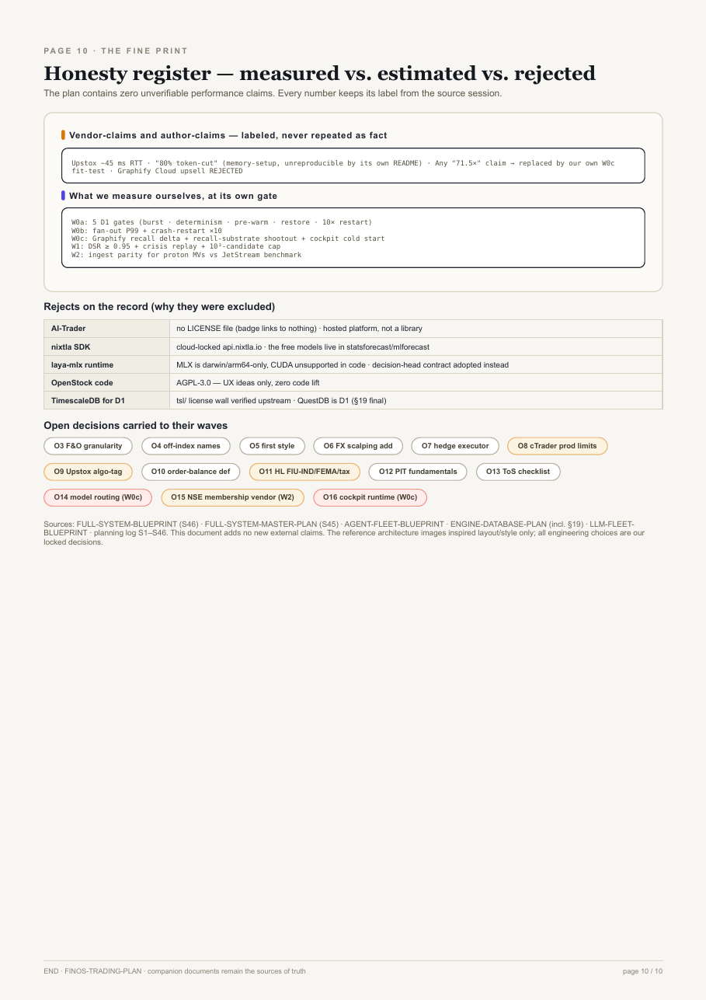

# Global financial trading intelligence

**One shared data foundation · three parallel engines · a private governed trading stack · a 12-seat LLM cockpit that runs the whole thing with the owner in the chat.**

This repository is the build home of the entire system. The complete plan set lives in
[`docs/plans/`](docs/plans/) (15 PDFs + markdown sources). This README is the **full,
in-depth plan with the complete visual diagrams** — the same 10 architecture pages of
[FINOS-TRADING-PLAN.pdf](docs/plans/FINOS-TRADING-PLAN.pdf), embedded here with the
full structures spelled out under each.

> Status: **W0a DONE · W0b (ledger + kill-cascade) DONE-at-gate level** — MEASURED:
> rail ingest contract 6/6 tests · **90 ns/row (p99 182 ns) ≈ 11.1 M rows/s/core** ·
> batched-flush publish 2.7–3.0× · D0 Parquet **289 ns/row** · ILP encode
> **639 ns/row** · Compose stack (Postgres 16 · QuestDB 7.4.2 · NATS 2.10) 3×
> healthy · five D1 store gates green (500k burst exact · determinism identical ·
> pre-warm 154 ms cold / 6.6 ms warm · restore reverts markers · 10× restart
> invariant) · **W0b**: D4 append-only enforced by DB triggers (real trigger text
> in evidence) · kill drill with fail-closed rc7 · Postgres restart ×10 ·
> batched signed appends **~0.4–0.5 ms/row** (vs 25.8 ms/row autocommit baseline)
> with 20,000/20,000 signatures verified · fan-out bench 4 cells exact-count,
> **worst p99 1.68 ms ≤ 2 ms budget** · out-of-band watchdog (fail-closed drills,
> live cascade detection in 140 ms) · **E-cell skeletons G7**: E1+E2+E5 p50
> 525 ns / p99 7.5 µs, fail-closed phase 4/4 refuse + 0 intents, open phase
> 4 allows → 4 signed fills, bad_sigs 0 · **approval flow G8**: L1/L2/L3
> ladder enforced (seat-overreach rc 8, double-decide rc 9, C8 quota 5
> grants/week then rc 7) — see `docs/gates/W0a.md` and
> `docs/gates/W0b.md` for verbatim outputs. **W0b complete** (G1–G8).
> Next: B1 data gathering & quality.> Labels used everywhere below: **ESTIMATE** = projected, measured at its named gate ·
> **MEASURED** = real recorded output · unlabelled = a locked decision from the sessions.

---

## 1 · What the system is (the one-page picture)



**Raw 1 — public content** (built LAST in the whole project): Terminal · News portal ·
Media hub. It *reads* the engines through the rights firewall and never feeds anything
back into trading.

**Row 2 — shared intelligence foundation**: the Financial engine + News engine + World
engine and the shared machinery (registry, schemas, provenance, quality, bus, APIs,
rights). Rule: **collect once, reuse many**.

**Row 3 — private**: **FinOS** (the trading stack — the core of this repo) ·
**Cockpit** (the LLM layer: 12 seats, memory, approvals, chat with the owner) ·
**World Monitor** (last of all).

| Workforce | Size | What it does |
|---|---|---|
| Non-LLM fleet — *the hands* | **75 research brains** → **480–545 executor cells** (ceiling), **≤75 active at once** | deterministic trading execution; every artifact is bit-for-bit replayable |
| LLM cockpit — *the management layer* | **12 seats** | organize · score · monitor · control · train · chat — decide-and-explain, **never the hot path** |
| Gates | the promotion ladder | DSR ≥ 0.95 + CPCV + crisis replay + 10³-candidates/style cap → owner approves ≤5/week → live |

**Roster note:** the owner's "73" was the old symbols×1-style count. The locked roster
is **75 research brains** (NIFTY+SENSEX+optionable weight-stocks = ≤59 · FX Team 1 = 11 ·
FX Team 2 = 2 · crypto = 3).

### Non-negotiable invariants (printed on every page of the build)

| # | Invariant |
|---|---|
| R1 | collect once / reuse many |
| R2 | rights firewall at the Row-1 boundary only |
| **R3** | **intelligence (LLM) never in fast paths** |
| R4 | point-in-time + survivorship discipline |
| R5 | provenance everywhere |
| R6 | versioned contracts |
| R7 | train → eval → paper → approve → deploy |
| R8 | HFT honesty: venue RTT dominates; internal order budget **<5 ms** |
| R9–R14 | regulatory set (India algo tagging, FIU-IND/FEMA, ≥5-yr records, …) |
| G1–G6 | guards: no self-editing artifacts · no search code live · research can't order · every trial logged · one style/symbol · Mode R/T separate processes |
| L0–L4 | kill cascade cell → symbol → team → market → global + **out-of-band kill that works without the app** |

---

## 2 · The data pipeline (in motion → at rest → insight → action)



| Band | Exactly what lives there |
|---|---|
| **Data in motion** | venue feeds (Upstox WS+SSE for NSE/BSE · cTrader Open API for FX ECN · Hyperliquid perps) · news + world collectors (B1 wave; T3 world data pinned to research need, never blanket) · filings/reference/cyclical fundamentals (PIT as-reported — O12 open) — everything crosses the **R1 rail**: validate · as-of stamp · rights-tag |
| **The bus** | **NATS JetStream (D2)** — subjects `market.*` `signal.*` `order.*` `risk.*` `ledger.*` `seat.*` · queue-groups = load balancing · durable consumers = replay · partitioned per-key ordering · fan-out **≤ ~2 ms P99** (ESTIMATE → measured W0b) |
| **Data at rest** | **D0** Parquet lake (NVMe + offsite object; 16-TB target accepted) · **D1** **QuestDB** warm window (§19 final; ClickHouse fallback if W0a fails twice; TimescaleDB rejected — `tsl/` license wall) · **D3** Postgres reference/registry (+ `llm_tasks`) · **D4** Postgres **append-only** ledger (fills · P&L · slippage · G4 trials · ≥5 yr) |
| **Data at insight** | **D6** DuckDB scans (one process, columnar only) · **E4** gate stack · scoring + research seats (citations required; **10³ candidates/style cap**) |
| **Data at action** | **E5** governor (zero-ML) · **E6** execution (PAPER/SHADOW/LIVE) · **E7** ledger → D4 · cockpit approvals |

Store rules: the **hot path never queries a store per tick** · cold in D0, warm in D1,
hot in RAM, truth in D3/D4/D5 · a candidate's label triple-barrier net-of-costs comes
from the *signal log*, not fills.

---

## 3 · The runtime: three layers, one wall



| Layer | Members | Position |
|---|---|---|
| **Rust kernel** (edition 2024) | `rail/` R1 · `featurize/` E1 (pre-warmed RAM at boot) · `evaluate/` E2 (frozen-artifact evaluator, compiled/ONNX) · `govern/` E5 · `exec/` E6 + adapters · `ledger/` E7 | **hot path** — no framework, no store query per tick |
| **Python edge** | `research/` (PySR · MAPIE · arch · sklearn · PyTorch · SB3) · `gates/` (E4: CPCV · DSR · crisis replay · E4-SIM NumPy/Numba 10⁴ worlds) · `tools/` | offline nightly |
| **LLM seat layer** | the 12 seats + brigade loop-guard ports + ruflo DAG runner | approvals, PRs, findings — through the L0–L3 bridge **only** |

Crossings between layers = the **five versioned contracts**: storage · research ·
artifact · execution · audit. Monorepo (`rust/` `python/` `configs/` `compose/`), a
wall, not a shared runtime.

**Adopt vs build**

| | Items |
|---|---|
| **Build** (no substitute) | R1 rail · E1 · E2 · E5 · E6 adapters · E7 + cost model · D5/G4 · PIT replay · rights firewall · cockpit layer |
| **Adopt** (license-checked) | Parquet · QuestDB · NATS · Postgres · DuckDB · PySR · MAPIE · arch · sklearn/PyTorch/SB3 · Nautilus behind the E6 interface · Graphify as local tool |
| **Port patterns** (13-repo deep-read) | brigade loop-guards/approval-bridge/cron · ruflo task DAG · agency personas · day-trader deterministic checks · quant-mind citation schema · Vibe-Trading anti-fabrication · timecopilot stub-gate |
| **Rejected on record** | AI-Trader (no LICENSE) · nixtla SDK (cloud-locked; free models live in statsforecast/mlforecast) · laya-mlx runtime (darwin/arm64 only) · OpenStock code (AGPL — ideas only) |

---

## 4 · The execution path (latency bands)



| Band | Content | Budget |
|---|---|---|
| **HOT** | E5 risk **first** (pre-trade size/limits/spread/news ladder) → E1 pre-warmed features → E2 frozen-artifact evaluation → daily circuit kill | decision **<1 ms** · R1→cell fan-out **≤ ~2 ms P99** (W0b) · order path E1→E5→E6→wire **<5 ms internal** — **venue RTT dominates (R8)** |
| **WARM** | E6 order state machine · lifecycle · replay(es) · position reconciler (**reconcile-before-orders** invariant) · D4 position ledger | ms-class |
| **COLD** | G4 research + strategy library · E3 training (Colab T4 verified lane) · D5 feature store + model registry | seconds–minutes, off-peak |

| Venue | RTT | Note |
|---|---|---|
| Upstox | ~45 ms | **vendor-claim, labeled** · algo-tag digit pending (O9) |
| cTrader ECN | GA-routed | prod limits O8 (500/min is demo) · NY4 lane planning W3 |
| Hyperliquid | ~600–700 ms public API | **MEASURED** public figure · node option W4–W5 |

---

## 5 · The wire — five transports, nothing else



| # | Transport | Job |
|---|---|---|
| 1 | **NATS subjects** | the live wire — µs–ms fan-out · load-balance · durable replay |
| 2 | Files | D0/D5 — single-writer discipline |
| 3 | SQL | D1/D3/D4 concurrent servers (headroom = G1 bench) |
| 4 | Embedded DuckDB | single D6 process — never critical path |
| 5 | In-proc calls | E1/E4 workers — µs-class inside one kernel process |

Plus: schema registry = the five contracts (enforced at publish) · security layer =
rights firewall + no secrets in configs + append-only DB roles · observability =
per-hop metrics + flight-recorder traces + G2 dashboards + G9 token burn · the
cockpit L0–L3 bridge is the API-gateway analog · **proton** JetStream streaming-MVs =
W2 trial layer on top (own gates), **not** a D1 change.

---

## 6 · Engines E1–E7 and the candidate ladder



| Engine | One line |
|---|---|
| E1 featurize | bars · ticks · Greeks · indicators · microstructure — Rust, pre-warmed at boot |
| E2 evaluate | frozen-artifact evaluator every tick |
| E3 train | nightly, Colab T4 verified lane · every run G4-numbered |
| **E4 gate** | E4-SIM (10⁴ deterministic worlds) · E4-BT (vectorized → event-driven w/ fill model) · E4-WF (CPCV purge+embargo, day-grouped folds, untouched holdout) · **DSR ≥ 0.95** · crisis replay |
| E5 govern | stops · size caps · news ladder · kill-switch — **zero ML** |
| E6 execute | PAPER · SHADOW (zero order authority, physically) · LIVE adapters — the only engine that ever sends an order |
| E7 ledger | fills vs expected · slippage curves → D4 |

**A candidate's life (same signed artifact, same E1 code at every rung — bit-for-bit):**
E4-SIM (minutes) → E4-BT vectorized (seconds) → E4-BT event (fill model) → E4-WF
(CPCV + DSR + crisis) → **PAPER** (days) → **SHADOW** (3–6 months) → owner gate
(≤5 approvals/week) → **D5 signed → LIVE** → E7 decay watch → monitor / retrain /
retire (per-cell, owner-approved, G4 lineage).

---

## 7 · The workforces — and the ten operating loops



**The hands (deterministic fleet)**

| Market | Venue | The work | Exits/guards |
|---|---|---|---|
| Stocks ≤59 | Upstox | options **BUYING only**, same-day | rule ladder 1–6 + kill; no short gamma |
| FX Team 1 (11) | cTrader ECN | 3 styles/pair (session · carry · news); regime router picks ≤1 | cascade-flatten · weekend-gap · funding-window · kill |
| FX Team 2 (2) | cTrader **separate account** | pure scalping push-mode (needs tick+depth) | session-closed flat |
| Crypto (3) | Hyperliquid perps | funding · liquidation · weekend · PAIR stat-arb | liquidity-gate exit · kill |

**The brain's management layer (12 seats)**: build · review · cybersec ·
data-QA · news · research · scoring · ops · fleet-control · training · compliance ·
cockpit/comm — findings and PRs only; **no market writes outside L0–L3, no
frozen-artifact edits without E4, no orders from research**.

**Ten operating loops** bind fleet ⇄ seats: build · fix-bug · promote · research ·
news · data-QA · ops/kill · train · monitor · self-learn. Nothing a seat says becomes
live without a gate.

**Swarms (both kinds)**: fleet swarm = E4-SIM 10⁴ worlds · LLM crew swarm = ruflo-port
DAG with `crew.yaml` (roster · depends_on · tool whitelist · budget cap · approval lid,
CI-linted) · cross-cell swarms test any new style against existing exposure before a
merge lands.

---

## 8 · Memory — every agent, and the control plane



| Memory type | Fleet (75 brains / 480–545 hands) | LLM seats (12) |
|---|---|---|
| working | cell process state (tick/feature/position/DD) | task-lease payload in `llm_tasks` |
| episodic | E7 ledger + G4 trial log + shadow history | D4 audit rows (tokens · result · artifacts) |
| semantic | **R3 registry**: frozen artifacts · calendars · limits · ban status · regime→style map | D5 artifacts + Graphify knowledge graph + vault notes |
| procedural | the code + runbooks (git PR only) | skill files (PR + review) |
| owner rules | — | vault note, cockpit-seat-writes-only |

Write authority is **enforced at the DB-role level** (no seat can UPDATE D4; D5 writes
only via the gated artifact path) · retention: D4 ≥5 yr · G4 forever · `llm_tasks`
trimmed after digest · Obsidian note types (decision · incident · runbook ·
research-digest · training-record) · recall substrate decided by the **W0c measured
shootout**.

**Control plane:** owner tiers **L0** chat answers → **L1** sandbox checks →
**L2** sign-offs (news ladder, budgets, triage) → **L3** live decisions (promote, kill
re-arm, deploy) as approval cards in chat · kill cascade **L0–L4** + out-of-band
watchdog + venue-side max-loss order + one-action mobile kill — all work without the
app · monthly chaos drills (10× restart · feed-stale · venue-down · restore).

**Cockpit monitor surfaces (G2):** cell health · portfolio · market state · data
(gap calendar + 16-TB tracker) · LLM layer (token burn/seat/day) · research (trial
counts, DSR status, coverage heat) · ops (incident queue, drill results, backup
freshness). Chat: every reply labeled ESTIMATE/MEASURED; every quote carries its
artifact id; weekly digest auto-writes to the vault.

---

## 9 · The build order — waves with exit pins



| Wave | Builds | Exit pin (real command output, filed) |
|---|---|---|
| **W0a** | monorepo skeleton · Compose (Postgres · QuestDB · NATS) · R1 rail · 5 D1 gates (burst · determinism · pre-warm · restore · 10× restart) | replay twice bit-identical · bench JSON |
| **B1** | collectors market/news/world · 6–10 y backfill per tiers · in-DB gaps table | **B-GATE verified before ANY agent trains** |
| **W0b** | D4/D5 roles+signing · E1/E2/E5/E7 skeletons · L0–L4 + watchdog · fan-out bench | restart ×10 · fan-out p99 file · kill drill log |
| **W0c** | LLM control plane · `llm_tasks` · Graphify+Obsidian · cockpit v1 | cold start · 10× Compose restart · substrate numbers |
| **W1** | D6 cache · PySR/MAPIE/arch · E4-SIM/BT/WF · E6-PAPER | one full style through the ladder to a signed D5 artifact |
| **W2** | cost model (O8) · cTrader adapter · proton MV trial · seats live | paper fills + E7↔broker reconcile |
| **W3** | first cells to shadow · NY4 lane | shadow P&L/IC files — no live claims |
| **W4–W5** | tick+depth → microstructure · Hyperliquid node · crypto cells · ML lane | microstructure replay · colo decision |
| **Stage 6** | cockpit GA (O16 resolved) | L3 flow demo · weekly digest in vault |
| **Stages 7–10** | Terminal/Portal/Media (rights-firewalled) · World Monitor LAST · HFT only if measured | Row-1 never touches the hot path |

**Week-1 concrete instructions:** create the skeleton · Compose with healthchecks ·
R1 minimal loop (validate → stamp → `market.*` → D0 parquet) · replay-harness CLI ·
G1 bench stub · import the plans into `docs/` · create vault note types · Graphify
baseline · open the W0a gate document.

---

## 10 · Honesty register — the fine print this build runs on



- **Vendor/author claims stay labeled, never repeated as fact:** Upstox ~45 ms RTT
  (vendor-claim) · "80% token cut"/"71.5× fewer tokens" (author-reported, unreproducible
  by the source's own README) → replaced by **our own W0c fit-test** · Graphify Cloud
  upsell rejected.
- **Measured by us, at each gate:** W0a's 5 store gates · W0b fan-out + restart ×10 ·
  W0c recall deltas + substrate shootout + cockpit cold start · W1 DSR/crisis/cap ·
  W2 ingest parity.
- **Open decisions carried to their waves:** O3 F&O granularity · O4 off-index names ·
  O5 first style · O6 FX-scalping add · O7 hedge executor · O8 cTrader prod limits ·
  O9 Upstox algo-tag · O10 order-balance · O11 HL FIU-IND/FEMA/tax · O12 PIT
  fundamentals · O13 ToS checklist · **O14** model routing (W0c) · **O15** NSE
  membership vendor (W2) · **O16** cockpit runtime (W0c).
- This plan set contains **zero unverifiable performance claims** — anything
  vendor- or author-reported keeps its label until we measure it.

---

## Repo map

```
Global financial trading intelligence/
├── README.md            ← this document (the full plan + all 10 diagrams)
├── docs/plans/          the complete plan shelf: 15 PDFs + md sources + FINOS visual html
├── docs/img/            the 10 architecture pages as PNGs (rendered from FINOS-TRADING-PLAN.pdf)
├── rust/                the hot-path kernel: rail · featurize · evaluate · govern · exec · ledger
├── python/              the edge: research · gates · seats · tools
├── configs/             subjects · schemas · rights classes · calendars
└── compose/             container stack: Postgres · QuestDB · NATS · cockpit
```

The language boundary is a wall (Rust kernel ⇄ Python seats, contracts across). The
build starts at **W0a**; plan sources: `docs/plans/FULL-SYSTEM-BLUEPRINT.md` (pinned
build doc) · `FULL-SYSTEM-MASTER-PLAN.md` (overview) · `AGENT-FLEET-BLUEPRINT.md` ·
`ENGINE-DATABASE-PLAN.md` · `LLM-FLEET-BLUEPRINT.md` · the session log.

*No secrets in this repository (scanned at seed time). License: to be decided by the
owner — unlicensed means all rights reserved.*
